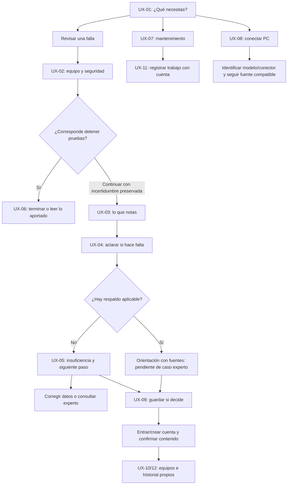

# Diseño funcional para revisión — UX R1

**Estado:** borrador  
**Versión:** 0.3 — UX R1, 2026-11-16  
**Responsable:** Producto; propietario humano por identificar para aprobaciones

## Cambio solicitado y resultado

El solicitante pidió mejorar la UX, eliminar las propuestas actuales y seguir. Se retiraron todas las instancias anteriores del canvas y se eliminaron siete capturas locales. El conector no ofrece eliminación individual permanente de recursos de pantalla; el proyecto se conserva y el canvas vigente contiene solo la nueva propuesta.

La revisión del agente detectó formularios largos, advertencias repetidas, títulos truncados y textos de implementación visibles. Son observaciones sobre las pantallas; no pruebas de usabilidad con personas.

Se propone una entrada por intención y pasos breves, con una siguiente acción clara. La cuenta aparece cuando se decide guardar. El rediseño no cambia el público, el plazo de dos semanas de discovery ni las funciones confirmadas. El caso del mecánico se deja pendiente, tal como pidió el solicitante; no se inventa una causa para completar una pantalla.

## Prototipo real

[Proyecto privado en Stitch](https://stitch.withgoogle.com/projects/15119609733945067300), recurso `projects/15119609733945067300`. Nuevo sistema visual `assets/13789972946781811835`, Guía Clara (nombre de trabajo), móvil, azul/blanco, Manrope/Inter y tarjetas ligeras.

La propuesta R1 tiene doce vistas. Recursos, versiones, capturas y hashes están en `design/stitch-review.json`. La propuesta anterior está descartada y sus capturas no son la referencia vigente. El registro de descarte conserva trazabilidad, no propuestas activas.

**SHA-256 del índice de esta revisión:** `25232cf8f84a6ad63383e5a4ab4ee3a11519a64abfbfe9bcdadee582fe1b7a23`.

| Vista | Qué se diseñó | Función |
|---|---|---|
| UX-01 Inicio | Revisar falla, mantenimiento o conectar PC; acceso a cuenta opcional | Entrada por tarea |
| UX-02 Equipo | Auto/PC, datos desconocidos válidos y comprobación de seguridad antes de captura | RF-001/002/003 |
| UX-03 Síntoma | Descripción, medios opcionales e información de uso de archivos | RF-002 |
| UX-04 Aclaración | Una pregunta concreta y «No lo recuerdo» | RF-003 |
| UX-05 Siguiente paso | Información insuficiente, corrección o experto; guardar después | RF-003/006 |
| UX-06 Seguridad | Detener pruebas; leer lo aportado o terminar | RF-003 |
| UX-07 Mantenimiento | Pauta cuando corresponda y registros de trabajos | RF-004 |
| UX-08 Conectar PC | Monitor/teclado/mouse, equipo/conector y preparación de guía del fabricante | RF-005 |
| UX-09 Guardar | Cuenta opcional y medios desactivados por defecto | RF-006 |
| UX-10 Equipos | Biblioteca de identidad propia; añadir/ver y mantenimiento | RF-001/004/006 |
| UX-11 Trabajo | Registro personal, fecha, detalle y kilometraje opcional | RF-004/006 |
| UX-12 Historial | Consultas y trabajos propios, filtros y detalle | RF-006 |

Las capturas se inspeccionan como propuestas, no como evidencia de navegación ejecutable, análisis, guardado, autenticación o instalación. No se enviaron archivos reales a un servicio de diagnóstico. Los equipos/fechas/registros de muestra son ficticios y no demuestran uso ni eficacia.

## Qué hace cada función

- **Identificar:** pedir contexto mínimo y ampliar solo cuando la tarea/fuente lo requiera. Desconocer modelo no se convierte en compatibilidad asumida. Corregir equipo invalida una pauta específica que ya no corresponda.
- **Aportar síntomas:** texto o medios apropiados, sin obligar a obtener material peligroso. Permisos al usar cámara/micrófono; alternativas ante denegación o fallo.
- **Orientar:** distinguir datos reportados, respaldo e incertidumbre. Aclarar con preguntas cortas; no afirmar una causa cuando falta evidencia. La vista con causas sustentadas queda pendiente del caso experto.
- **Mantenimiento:** separar pauta del fabricante de registros declarados. No inventar intervalos, certificar trabajos ni agregar avisos iniciales.
- **Guías PC:** solo periféricos externos, fuente/modelo/conector pertinentes y preparación antes de pasos. Referencias documentales Dell P2422H y Logitech MK120 en02; revisión de experto y detalle de pasos pendientes.
- **Guardar:** después de orientar, mostrar contenido y elección de cuenta. Resúmenes por decisión; medios solo por elección adicional. Solo historial/equipos propios; no seleccionar arquitectura de almacenamiento desde el diseño.

Campos, validaciones, permisos, estados y criterios específicos en [02-requirements.md](02-requirements.md).

## Recorridos



Una respuesta «No» o «No sé» sobre peligro no acredita seguridad. La rama de continuación no permite por sí misma pruebas; clasificar y definir comprobaciones concretas requiere revisión experta. Los enlaces del diagrama son comportamiento propuesto, no un recorrido clicado/validado.

```stateDiagram-v2
    [*] --> Consulta
    Consulta --> Aclaracion: falta contexto
    Consulta --> Detenida: peligro reportado
    Aclaracion --> Insuficiente: no hay respaldo
    Aclaracion --> Orientacion: hay respaldo aplicable
    Insuficiente --> Consulta: corregir lo ya conocido
    Insuficiente --> Terminada: finalizar
    Orientacion --> Terminada: finalizar
    Detenida --> Terminada: sin nuevas pruebas
    Terminada --> GuardadoElegido: decide guardar
    GuardadoElegido --> AccesoCuenta: visitante
    AccesoCuenta --> ConfirmarContenido: acceso correcto
    GuardadoElegido --> ConfirmarContenido: ya tiene cuenta
    ConfirmarContenido --> Guardado: confirmación efectiva
    ConfirmarContenido --> ErrorGuardado: falla
    ErrorGuardado --> ConfirmarContenido: recuperar sin duplicar
```

Guardar no convierte una orientación en diagnóstico. La salida de seguridad no solicita más medios para poder terminar. La definición de conservación temporal y recuperación sigue pendiente.

## Excepciones, accesibilidad y soporte

El diseño final debe cubrir consulta vacía, permisos denegados, archivo incompatible, medio no analizado, desconexión, fallo del proveedor, fuente ausente/no aplicable, acceso denegado, guardado duplicado y recuperación. No confundir un error del servicio con una conclusión sobre el equipo.

R1 busca etiquetas claras, lectura completa de datos y controles amplios. Falta auditoría de contraste, foco, lector de pantalla, escalado y uso en dispositivos reales. No se presenta el cambio de estilo como mejora de usabilidad medida.

Operación necesita circuito de reclamación/corrección de consejos, revisión de fuentes, solicitudes sobre datos y fallos de consulta/guardado. Responsables, canal/horario, permisos de soporte, auditoría, dashboards, alertas y recuperación por acordar; vistas operativas aún pendientes. No hay atención profesional incorporada ni SLA inventado.

## Revisión humana y salida

La solicitud de rediseño autoriza este trabajo; no aprueba R1. Falta revisar el nuevo conjunto y completar normalidad con fuentes/caso experto, detalle de PC/guías, cuenta/acceso y recuperación, errores y operación.

Mantener 02/12 coherentes, exportar referencia estable final y mostrarla a responsables. Después de resolver observaciones, recoger confirmación explícita product-design/functional sobre fingerprint vigente. Solo entonces crear épica/historias funcionales, sincronizar/readback Jira y obtener negocio/legal sobre el hash Product final.

**Confirmación final:** ninguna. Producto sigue draft; no hay handoff a Engineering.
